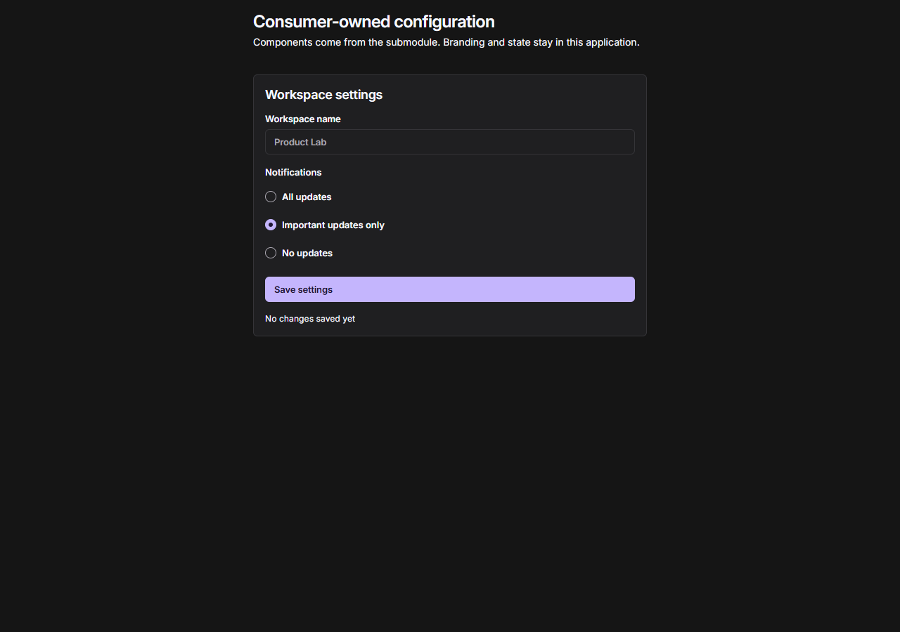
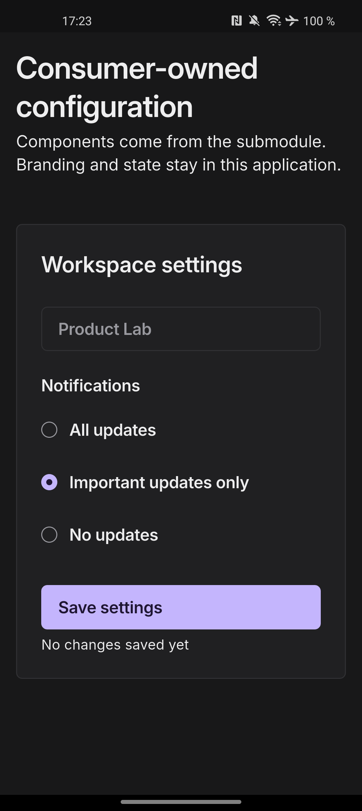

# K Design System

K Design System is a cross-platform component library for React/Web and Flutter.
It provides shared primitives, accessible components, responsive patterns and a
platform-neutral design-token source while keeping product state and business
logic in the consuming application.

The repository is currently being hardened for its first supported release.
Storybook and Widgetbook are the visual review surfaces; the package APIs are the
consumer boundary.

## What it provides

- React and Flutter components with equivalent intent and interaction behavior.
- Foundation, semantic and component token tiers generated from one DTCG source.
- Project-level theming through CSS custom properties on Web and a generated
  `ThemeExtension` transform on Flutter.
- Responsive patterns for pointer and touch input, including mobile Web.
- Storybook and Widgetbook fixtures for interaction and visual acceptance.
- Consumer examples that verify installation outside the gallery applications.

## Cross-platform consumer example

The runnable examples use the same settings composition and interaction model on
Web and Flutter. Their theme overrides live in the consumer applications; the
controls and defaults come from this repository.

| Web consumer                                  | Flutter consumer on Android                           |
| --------------------------------------------- | ----------------------------------------------------- |
|  |  |

The current implementation status is recorded in the
[component catalog](docs/component-catalog.md). A catalog entry is not a promise
that a component is already part of the public package API.

## Repository layout

| Path                               | Purpose                                   |
| ---------------------------------- | ----------------------------------------- |
| `tokens`                           | Platform-neutral token sources and themes |
| `packages/web/tokens`              | Generated Web token package               |
| `packages/web/ui`                  | React components and styles               |
| `packages/flutter/k_design_tokens` | Flutter token package and theme factory   |
| `packages/flutter/k_design_ui`     | Flutter components                        |
| `apps/storybook`                   | Web gallery and review surface            |
| `apps/widgetbook`                  | Flutter gallery and review surface        |
| `examples/web`                     | External Web consumer verification        |
| `examples/flutter`                 | External Flutter consumer verification    |

## Use from another project

The supported repository workflow pins the design system as a Git submodule.
The host application owns its token overrides, configuration, product data and
navigation. The submodule owns reusable components and the shared defaults.

```bash
git submodule add https://github.com/Knaackee/k-design-system.git vendor/k-design-system
git submodule update --init --recursive
```

Web projects reference the local packages:

```json
{
  "dependencies": {
    "@k-design-system/tokens": "file:./vendor/k-design-system/packages/web/tokens",
    "@k-design-system/ui": "file:./vendor/k-design-system/packages/web/ui"
  }
}
```

```tsx
import "@k-design-system/tokens/tokens.css";
import "@k-design-system/ui/styles.css";
import "./design-system/theme.css";

import { KButton } from "@k-design-system/ui";

export function SaveAction() {
  return <KButton onClick={() => undefined}>Save</KButton>;
}
```

Flutter projects use local path dependencies:

```yaml
dependencies:
  k_design_tokens:
    path: vendor/k-design-system/packages/flutter/k_design_tokens
  k_design_ui:
    path: vendor/k-design-system/packages/flutter/k_design_ui
```

```dart
import 'package:flutter/material.dart';
import 'package:k_design_tokens/k_design_tokens.dart';
import 'package:k_design_ui/k_design_ui.dart';

MaterialApp(
  theme: kDesignTheme(
    tokenTransform: (tokens) => tokens.copyWith(
      radiusControl: 0,
    ),
  ),
  home: KButton(label: 'Save', onPressed: () {}),
);
```

See the complete [integration guide](docs/integration/submodule.md), including
build steps, project-owned theming and safe submodule updates. Existing projects
can follow the [migration guide](docs/integration/migration.md).

## Develop the library

Required tools:

- Node.js 22
- pnpm 11
- Flutter 3.44 / Dart 3.12

```bash
pnpm install --frozen-lockfile
dart pub get
pnpm storybook
pnpm widgetbook
```

Storybook runs at `http://localhost:6006`; Widgetbook runs at
`http://localhost:6007`.

Run the complete repository verification before proposing a commit:

```bash
pnpm verify
```

Generated sources are never edited directly. Change token, icon, locale or emoji
sources and run `pnpm generate`.

## Contribution workflow

Before adding UI to an application, search the public packages and both galleries.
When a reusable component is missing, implement it in the submodule for Web and
Flutter, add matching gallery fixtures, verify it and obtain human visual
acceptance. Only then integrate it into the host application and update the
host's submodule pointer.

Application branding belongs in project-local overrides. A request to change a
design token must be classified explicitly as either a host override or a shared
design-system default before any token source is edited.

Read [CONTRIBUTING.md](CONTRIBUTING.md) and the reusable
[consumer workflow skill](.agents/skills/k-design-system-workflow/SKILL.md) for
the full contract.

## Documentation

- [Consumer integration](docs/integration/submodule.md)
- [Migration for existing projects](docs/integration/migration.md)
- [Consumer theming](docs/components/theming.md)
- [Timeline and Gantt](docs/components/timeline-gantt.md)
- [Component catalog](docs/component-catalog.md)
- [Architecture decisions](docs/decisions/README.md)
- [Release process](docs/integration/releasing.md)
- [Changelog](CHANGELOG.md)

## Status and licensing

Package versions remain pre-release until the release checklist is complete.
Do not infer stability from a gallery fixture alone. Third-party asset licenses
are kept beside the affected package assets. A repository-wide distribution
license must be present before a public release.
